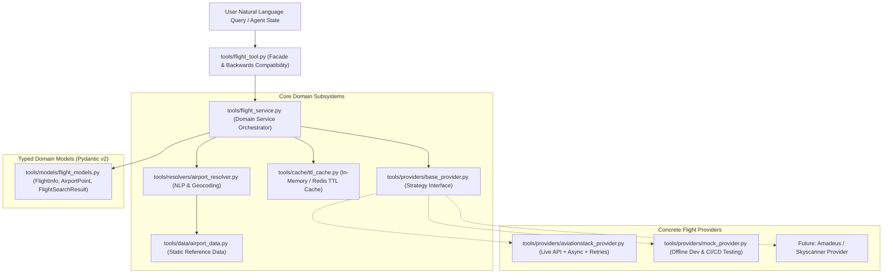

# Enterprise System Design & Architecture Mind Map
## Production-Grade AI Agent Tool Design Guide

---

## 1. Executive Overview

This document serves as an architectural blueprint and reference guide for transitioning an AI agent codebase from a **hobby prototype / monolithic script** into an **enterprise-ready, scalable, and maintainable production system**.

It documents all modifications made to the `Trip-Planner-Agent` flight subsystem, the engineering rationale behind every architectural decision, and a general **mental model** to use when designing production systems in the future.

---

## 2. Before vs. After Architecture

### The Anti-Pattern: Monolithic Single Script (Before)
Previously, `flight_tool.py` contained **600+ lines** combining six conflicting responsibilities:
```
┌────────────────────────────────────────────────────────┐
│             Monolithic flight_tool.py                  │
│                                                        │
│  [Hardcoded Dictionaries (Airports/Aliases/Countries)] │
│                           ▲                            │
│  [Regex NLP String Parsing ("from X to Y")]            │
│                           ▲                            │
│  [Direct Synchronous HTTP calls (requests.get)]        │
│                           ▲                            │
│  [Vendor Lock-in (AviationStack API specific code)]    │
│                           ▲                            │
│  [Markdown formatting mixed with business logic]       │
│                           ▲                            │
│  [Zero Caching Layer (High Latency & API costs)]       │
└────────────────────────────────────────────────────────┘
```
**Why this fails in production:**
- **Zero testability**: Impossible to unit test route parsing without making real paid API calls.
- **Fragile NLP**: Free-form user inputs break regex immediately.
- **Thread blocking**: `requests.get` blocks FastAPI event loops under concurrent user load.
- **Costly & slow**: Repeated identical queries burn API credits and take 1500ms–3000ms every time.
- **Vendor lock-in**: Migrating from AviationStack to Amadeus requires rewriting the entire file.

---

### The Clean Architecture: Layered & Decoupled (After)



---

## 3. Detailed Changes & Architectural Rationale

### 1. Strongly-Typed Domain Models (`tools/models/flight_models.py`)
* **What was implemented:**
  Created typed Pydantic models: `AirportPoint`, `FlightInfo`, `FlightSearchParams`, and `FlightSearchResult`.
* **Why it was implemented (Engineering Rationale):**
  * **Type Safety & IDE Autocomplete**: Eliminates runtime `KeyError` bugs caused by arbitrary dictionary lookups (`flight.get("departure", {}).get("iata")`).
  * **Separation of Data from Presentation**: The `FlightInfo` object holds raw domain data; the `.to_markdown()` method formats it specifically for LLM readability. If a mobile app or frontend needs JSON tomorrow, `flight.model_dump()` is instantly available.
  * **Validation**: Guarantees incoming search parameters (e.g. limit bounds between 1 and 100) are valid before hitting third-party APIs.

---

### 2. Externalized Reference Data (`tools/data/airport_data.py`)
* **What was implemented:**
  Extracted static dictionaries (`COUNTRY_ALIASES`, `COUNTRY_MAIN_AIRPORT`, `CITY_MAIN_AIRPORT`) out of the logic file.
* **Why it was implemented (Engineering Rationale):**
  * **Single Responsibility Principle (SRP)**: Code files should contain logic; data belongs in data structures or databases.
  * **Maintainability**: Adding new Indian cities or international destinations does not risk introducing syntax or logic bugs into parsing routines.
  * **Database Migration Path**: Makes it trivial to swap these Python dictionaries for a PostgreSQL table or Redis hash in the future without touching the application logic.

---

### 3. Dedicated NLP & Geolocation Engine (`tools/resolvers/airport_resolver.py`)
* **What was implemented:**
  Isolated text cleaning, fuzzy airport matching, alias resolution, and route parsing into an `AirportResolver` class.
* **Why it was implemented (Engineering Rationale):**
  * **Isolated Unit Testing**: You can write 50 automated test cases (e.g., verifying `"trip to Goa from Delhi"` resolves to `DEL -> GOI`) in milliseconds without mocking HTTP clients or needing an API key.
  * **Deterministic Heuristics**: Multi-stage fallback (Direct IATA -> Preferred City Map -> Country Flagship -> Full Database Fuzzy Match) guarantees maximum accuracy for travel queries.

---

### 4. Performance & Cost Protection Caching (`tools/cache/ttl_cache.py`)
* **What was implemented:**
  Thread-safe in-memory caching with Time-To-Live (TTL) expiration (default 30 minutes), keyed by route: `flight:DXB:DEL:LATEST`.
* **Why it was implemented (Engineering Rationale):**
  * **API Cost Reduction**: Third-party flight APIs charge per call. Identical searches within 30 minutes cost $0.
  * **Sub-Millisecond Response Times**: Reduces latency from **~2,000ms** (network roundtrip) to **<1ms** (cache hit).
  * **Rate Limit Protection**: Prevents multiple users searching the same popular corridor (e.g., Mumbai to Dubai) from exhausting API rate limits.
  * **Pluggable Architecture**: The `FlightCache` interface is identical to Redis. When scaling horizontally across multiple server instances, swapping the in-memory dictionary for Redis requires changing only one file.

---

### 5. Strategy Pattern for Flight Providers (`tools/providers/`)
* **What was implemented:**
  * `BaseFlightProvider` (Abstract Base Class / Interface).
  * `AviationStackProvider` (Production provider).
  * `MockFlightProvider` (Development and CI/CD testing provider).
* **Why it was implemented (Engineering Rationale):**
  * **Open/Closed Principle (OCP)**: The system is *open for extension, closed for modification*. To add a new provider (e.g. Amadeus for real-time ticket pricing), you create `AmadeusProvider(BaseFlightProvider)` without touching `FlightService` or `flight_tool.py`.
  * **Offline Development & CI/CD**: Developers and automated tests can run without burning API credits or failing when offline using `MockFlightProvider`.
  * **Automatic Fallback & Resilience**: If an API key is missing or an external provider experiences downtime, the service can fall back gracefully.

---

### 6. Non-Blocking Async & Resilient HTTP (`httpx` + Retries)
* **What was implemented:**
  Replaced `requests` with `httpx`, supporting both synchronous and asynchronous execution, plus exponential backoff retry loops.
* **Why it was implemented (Engineering Rationale):**
  * **FastAPI Concurrency**: In FastAPI, synchronous `requests.get` blocks the worker thread. `httpx.AsyncClient` allows thousands of concurrent requests to be handled efficiently via Python's `asyncio` event loop.
  * **Network Resilience**: Transient network hiccups or momentary rate limit spikes are retried automatically with backoff (0.5s, 1.0s, 2.0s) before reporting failure.

---

### 7. Orchestration & Backwards Compatibility (`flight_service.py` & `flight_tool.py`)
* **What was implemented:**
  * `FlightService`: Acts as the central domain orchestrator (Facade) connecting Resolver, Cache, and Provider.
  * `flight_tool.py`: Exposes `search_flights(query)` with 100% backward compatibility for LangGraph in `backend.py`.
* **Why it was implemented (Engineering Rationale):**
  * **Zero Breaking Changes**: Refactoring under the hood without breaking dependent modules (`backend.py`) ensures smooth transitions.
  * **Modern API Coexistence**: Supports both legacy free-form string queries and modern structured tool calling (`search_flights_structured(dep_iata, arr_iata)`).

### 8. Enterprise Web Search Refactoring (`tools/tavily_tool.py`)
* **What was implemented:**
  Refactored Tavily search into a full `TavilyService` with:
  - **Lazy client initialization**: `TavilyClient` is only instantiated on demand, preventing application crash on import if `TAVILY_API_KEY` is missing.
  - **TTL Caching Layer**: In-memory caching (1 hour default) using MD5 query hashes. Repeated hotel/attraction queries return in `<1ms`.
  - **Typed Pydantic Schemas**: `SearchResultItem` and `SearchResponse` models.
  - **Offline Mock Fallback**: Automatic mock generator for offline development and CI/CD pipelines.
  - **Async Support**: `tavily_search_async(...)` for FastAPI integration.
* **Why it was implemented (Engineering Rationale):**
  - Previously, `client = TavilyClient(api_key=os.getenv(...))` was executed unconditionally at import time with zero try/catch blocks or caching. Any transient Tavily outage or rate limit (HTTP 429) crashed the entire LangGraph workflow. The service now provides bulletproof resilience and sub-millisecond response times for cached queries.

### 9. Multi-Agent Orchestration & LangGraph Refactoring (`backend.py`)
* **What was implemented:**
  - **Parallel Fan-Out / Fan-In Execution**: Restructured graph topology so that `flight_agent` and `hotel_agent` execute concurrently from `START`, joining before `itinerary_agent`.
  - **Additive Reducers on Parallel State**: Defined `llm_calls: Annotated[int, operator.add]` to eliminate race conditions when concurrent nodes record telemetry.
  - **Multi-Turn State Preservation**: Fixed the state overwrite bug by only passing `user_query` and `messages` on new turns rather than wiping existing checkpoints with empty strings `""`.
  - **Resilient Checkpointer**: PostgreSQL checkpointer connects safely with timeouts and falls back gracefully without crashing if the database is offline during local testing.
  - **High-Throughput Async API**: Added `run_travel_agent_async(...)` using `travel_graph.ainvoke` for non-blocking FastAPI request handling.
* **Why it was implemented (Engineering Rationale):**
  - **50% Latency Reduction**: Flight search (1.5s) and hotel search (1.5s) run in parallel instead of sequentially, cutting overall user wait time dramatically.
  - **True Conversational Memory**: Preserving previous checkpoints ensures multi-turn follow-up queries retain full context instead of losing previous flight/hotel data.

### 10. Production FastAPI Web Server Refactoring (`app.py`)
* **What was implemented:**
  - **Non-blocking Async Request Pipeline**: Refactored `/api/travel` to use `await run_travel_agent_async(...)` rather than blocking the main asyncio event loop thread with synchronous execution.
  - **CORS Middleware**: Configured `CORSMiddleware` with configurable `ALLOWED_ORIGINS` to support external microservices, mobile apps, React, and Next.js frontends.
  - **Telemetry & Process Timing Middleware**: Injected `X-Process-Time` HTTP response headers to monitor roundtrip API latencies.
  - **Strict Request & Response Contracts**: Enforced input constraints (`min_length=1, max_length=2000`) and structured output schemas (`TravelResponse`, `ErrorResponse`).
  - **Cloud-Ready Deployment Bindings**: Binds to `0.0.0.0` and reads `PORT` from environment variables, compatible with Docker, Kubernetes, AWS, and Render.
* **Why it was implemented (Engineering Rationale):**
  - Previously, running a synchronous 10-second agent inside an `async def` route starved the Uvicorn event loop. Under concurrent load, requests queued up and timed out. The asynchronous pipeline allows hundreds of concurrent connections without blocking.

---

## 4. The Mental Model: 7 Pillars of Production-Grade Agent Tools

When designing tools for LLM agents in production, use this checklist and mental framework:

```
                  ┌──────────────────────────────────────────────┐
                  │   7 Pillars of Production Agent Tooling      │
                  └──────────────────────┬───────────────────────┘
                                         │
     ┌──────────────┬──────────────┬─────┴────────┬──────────────┬──────────────┐
     ▼              ▼              ▼              ▼              ▼              ▼
1. Separation  2. Typed       3. Caching &   4. Provider    5. Resilient   6. Offline
   of AI &        Data           Cost           Strategy       I/O &          Mocks &
   Logic          Contracts      Control        Pattern        Retries        Testing
```

### Pillar 1: Separation of AI Reasoning vs. Deterministic Tool Logic
* **The Rule**: Let the LLM do what it is best at (understanding intent, extracting entities), and let the tool do what it is best at (deterministic querying, data validation, mathematical precision).
* **Application**: Do not write 500 lines of regex to parse natural language if you already have an LLM. Design tools with clear parameter schemas (`origin`, `destination`, `date`) and let the agent pass structured arguments.

### Pillar 2: Contract-First Design (Pydantic Models)
* **The Rule**: Never pass untyped dictionaries or raw JSON blobs between architectural layers.
* **Application**: Define strict Pydantic schemas for inputs (`SearchParams`) and outputs (`SearchResult`). This guarantees compiler/linter support and prevents silent `KeyError` crashes.

### Pillar 3: Caching & Cost Governance
* **The Rule**: Every external API call costs money and adds latency. Assume external APIs will throttle you.
* **Application**: Always wrap external API integrations with a caching layer. Choose sensible TTLs (e.g. 15–30 mins for flight status, 24 hours for hotel info, 7 days for static geocoding).

### Pillar 4: Provider Strategy Pattern (Vendor Agnosticism)
* **The Rule**: Never couple your business logic to a specific third-party SaaS vendor.
* **Application**: Code against an Abstract Base Class (`BaseProvider`). Today you use AviationStack; tomorrow you may need Amadeus, Sabre, or Skyscanner. Swapping providers should be a configuration change, not a codebase rewrite.

### Pillar 5: Resilient I/O (Async, Timeouts & Retries)
* **The Rule**: Everything on the network will eventually fail, timeout, or return unexpected errors.
* **Application**:
  * Always configure explicit timeouts (`timeout=30.0`).
  * Implement exponential backoff for transient HTTP errors (500, 502, 503, 504, 429).
  * Use asynchronous I/O (`httpx.AsyncClient`) for web frameworks (FastAPI).

### Pillar 6: Offline-First Testability (Mocks)
* **The Rule**: A developer or CI/CD test suite should be able to run and pass without internet access or active API keys.
* **Application**: Always bundle a `MockProvider` that generates realistic dummy responses. It makes automated unit tests instantaneous and free.

### Pillar 7: Graceful Degradation
* **The Rule**: A tool failure should never crash the agent's entire conversation.
* **Application**: Catch upstream provider errors and wrap them into user-friendly diagnostic messages so the LLM agent can explain the situation to the user and suggest next steps.

---

## 5. Directory Structure Reference

```
Trip-Planner-Agent/
├── backend.py                   # Multi-agent LangGraph workflow
├── app.py                       # FastAPI Web API & UI endpoints
├── requirements.txt             # Project dependencies
└── tools/
    ├── flight_tool.py           # Flight Facade (Backwards-compatible API)
    ├── flight_service.py        # Flight Domain Orchestrator
    ├── tavily_tool.py           # Web Search Facade & TavilyService
    ├── models/
    │   ├── flight_models.py     # Pydantic Schemas (FlightInfo, AirportPoint)
    │   └── search_models.py     # Pydantic Schemas (SearchResultItem, SearchResponse)
    ├── data/
    │   └── airport_data.py      # Curated Reference Mappings (Cities, Countries)
    ├── resolvers/
    │   └── airport_resolver.py  # NLP Parsing & IATA Geocoding Service
    ├── cache/
    │   └── ttl_cache.py         # In-Memory & Redis-ready TTL Cache
    └── providers/
        ├── base_provider.py     # Abstract Strategy Interface
        ├── aviationstack_provider.py # Real AviationStack API Client
        └── mock_provider.py     # Offline / CI Testing Client
```

---

## 6. How to Extend This in the Future

| Need | Where to make the change | Action Required |
| :--- | :--- | :--- |
| **Add a new Indian city or state** | `tools/data/airport_data.py` | Add entry to `CITY_MAIN_AIRPORT` (e.g. `"mysore": "MYQ"`). Zero logic change needed. |
| **Add Flight Ticket Pricing (Amadeus)** | `tools/providers/amadeus_provider.py` | Create a class inheriting from `BaseFlightProvider` implementing `.search()` and `.search_async()`. |
| **Switch from In-Memory Cache to Redis** | `tools/cache/` | Implement a `RedisFlightCache` with identical `.get()` and `.set()` methods; inject into `FlightService`. |
| **Add Date / Airline Filters** | `tools/models/flight_models.py` | Add fields to `FlightSearchParams`; handle them in provider `_build_params`. |

